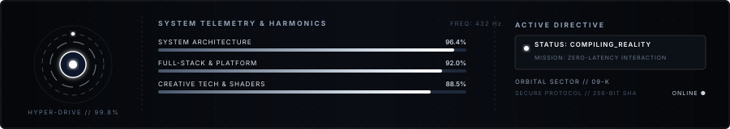
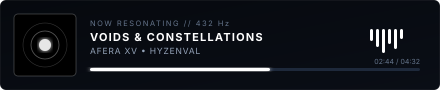

<div align="center">

  <!-- ================= HERO ANIMATIC BANNER ================= -->
  <a href="https://github.com/HyzenVal">
    
  </a>

  <!-- ================= CELESTIAL DIVIDER ================= -->
  

  <!-- ================= STATUS CHIPS ================= -->
  <p align="center">
    
    
    
    
  </p>

</div>

<br />

### 🛰️ `telemetry.sh` // Mission Briefing

```bash
hyzenval@celestial-void:~$ system-status --verbose
[✓] Core Frequency   : 432.00 Hz (Resonance Synced)
[✓] Identity Spec    : Creative Technologist & Full-Stack Architect
[✓] Primary Directive: Crafting fluid, high-performance digital realities & interactive worlds
[✓] Status           : Active on GitHub // Compiling future artifacts...
```

<div align="center">
  <!-- ================= LIVE TELEMETRY & SYSTEM METRICS ================= -->
  
</div>

<br />

<div align="center">
  
</div>

### 🌌 Core Pillars & Architecture

<table>
  <tr>
    <td width="50%" valign="top">
      <h4>⚡ System Philosophy</h4>
      <p>
        Walking between the boundary of deep system engineering and celestial audiovisual aesthetics.
        Dedicated to sub-millisecond responsiveness, cinematic user experiences, and clean modular codebases.
      </p>
      <ul>
        <li>🔭 <b>Architecting:</b> Next-generation web applications & interactive graphics</li>
        <li>🌱 <b>Exploring:</b> Low-latency distributed systems, shaders & real-time simulations</li>
        <li>🧬 <b>Design Style:</b> Monochrome, cyberpunk-minimalism & celestial dreamscapes</li>
        <li>💬 <b>Ask me about:</b> TypeScript, modern full-stack architectures & UI engineering</li>
      </ul>
    </td>
    <td width="50%" valign="top">
      <h4>📻 Resonating Broadcast</h4>
      <p align="center">
        
      </p>
      <p align="center">
        <i>"In the silence of the void, code is the constellation."</i>
      </p>
    </td>
  </tr>
</table>

<br />

### ⚔️ Tech Arsenal & Stack Matrix

<div align="center">

| Domain | Systems & Technologies |
| :--- | :--- |
| **Languages** |      |
| **Frontend & UI** |      |
| **Backend & Cloud** |      |
| **Tools & Creative** |      |

</div>

<br />

<div align="center">
  
</div>

### 📁 Active Orbital Deployments

```rust
struct Deployment {
    code_name: &'static str,
    target: &'static str,
    status: &'static str,
}

const ACTIVE_MISSIONS: [Deployment; 3] = [
    Deployment {
        code_name: "PROJECT // AFERA-01",
        target: "High-throughput interactive web graphics engine",
        status: "● IN_DEVELOPMENT",
    },
    Deployment {
        code_name: "CHRONO-VOID CORE",
        target: "Distributed state sync with zero-overhead websockets",
        status: "◆ DEPLOYED_V1",
    },
    Deployment {
        code_name: "GLITCH-SURFACE",
        target: "Procedural SVG & WebGL shader experiments",
        status: "▲ RESEARCH_LAB",
    },
];
```

<br />

### 📡 Transmission Channels // Connect

<div align="center">

  <p>Looking to collaborate on visionary products, open-source experiments, or high-performance systems?</p>

  <a href="https://github.com/HyzenVal">
    
  </a>
  &nbsp;
  <a href="https://x.com/">
    
  </a>
  &nbsp;
  <a href="https://discord.com/">
    
  </a>
  &nbsp;
  <a href="mailto:hyzenval@example.com">
    
  </a>

  <br/><br/>

  <p align="center">
    
  </p>

  <sub>HYZENVAL // ALL RIGHTS RESERVED • TRANSMISSION FREQ: 432.00 MHz • CELESTIAL PROTOCOL XV</sub>

</div>
