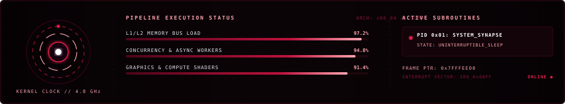
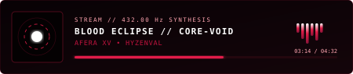

<div align="center">

  <!-- ================= HERO ANIMATIC BANNER ================= -->
  <a href="https://github.com/HyzenVal">
    
  </a>

  <!-- ================= CRIMSON LASER DIVIDER ================= -->
  

  <!-- ================= TELEMETRY CHIPS ================= -->
  <p align="center">
    
    
    
    
  </p>

</div>

<br />

### ⚡ `boot_sequence.sys` // Kernel Telemetry

```rust
// HYZEN-OS v4.19-void (x86_64-celestial-elf)
#[repr(C)]
pub struct KernelState {
    pub architect: &'static str,  // "HyzenVal"
    pub resonance: f32,           // 432.00 Hz
    pub latency: f32,             // 0.08 ms
    pub directive: &'static str,  // "Building low-latency digital worlds & high-performance engines"
    pub memory_lock: u64,         // 0x7FFF_ECLIPSE
}

const RUNTIME: KernelState = KernelState {
    architect: "HyzenVal",
    resonance: 432.00,
    latency: 0.08,
    directive: "Compiling fluid reality & low-level cyber systems",
    memory_lock: 0x7FFF_ECLIPSE,
};
```

<div align="center">
  <!-- ================= LIVE KERNEL MONITOR ================= -->
  
</div>

<br />

<div align="center">
  
</div>

### 🩸 Core Architecture & System Synapse

<table>
  <tr>
    <td width="50%" valign="top">
      <h4>🧬 Programmatic Philosophy</h4>
      <p>
        Operating at the intersection of deep systems programming, bare-metal efficiency, and dark celestial aesthetics.
        Engineered for sub-millisecond throughput, memory safety, and visual immersion.
      </p>
      <ul>
        <li>⚔️ <b>Architecting:</b> Distributed systems, high-concurrency runtimes & WebGL shaders</li>
        <li>🔬 <b>Low-Level Focus:</b> Memory mapping, zero-cost abstractions & event loops</li>
        <li>🌘 <b>Design Language:</b> Blood-moon eclipse, monochrome void & cyber-manga precision</li>
        <li>📡 <b>Open For:</b> Systems architecture, creative computing & high-stakes engineering</li>
      </ul>
    </td>
    <td width="50%" valign="top">
      <h4>📻 Resonating Broadcast</h4>
      <p align="center">
        
      </p>
      <p align="center">
        <i>"In the deep silence of the void, every byte is an orbit."</i>
      </p>
    </td>
  </tr>
</table>

<br />

### ⚙️ Instruction Set & Tech Arsenal

<div align="center">

| Execution Layer | Technologies & Runtime Environments |
| :--- | :--- |
| **Core Systems** |      |
| **Interactive & Web** |      |
| **Cloud & Engine** |      |

</div>

<br />

<div align="center">
  
</div>

### 🧵 Active Subroutines & Threads

```assembly
; SUBROUTINE_MAP // HYZENVAL.EXE
SECTION .text
    global _start

_start:
    MOV RAX, 0xPROJECT_CRIMSON    ; High-throughput graphics engine
    CALL compile_pipeline         ; STATUS: ACTIVE [88%]
    
    MOV RBX, 0xCHRONO_WEBSOCKET   ; Zero-latency state sync protocol
    CALL spawn_daemon             ; STATUS: STABLE_V2
    
    MOV RDX, 0xNEO_SHADERS        ; Procedural celestial raymarching
    CALL render_frame             ; STATUS: RESEARCH_LAB
    
    RET
```

<br />

### 📡 Sockets & Signal Transmissions

<div align="center">

  <p>Establishing encrypted socket connection for collaborations and visionary builds:</p>

  <a href="https://github.com/HyzenVal">
    
  </a>
  &nbsp;
  <a href="https://x.com/">
    
  </a>
  &nbsp;
  <a href="https://discord.com/">
    
  </a>
  &nbsp;
  <a href="mailto:hyzenval@example.com">
    
  </a>

  <br/><br/>

  <p align="center">
    
  </p>

  <sub>HYZENVAL // KERNEL ECLIPSE • PROTOCOL AFERA-XV • SHA-256 SIGNED • ALL RIGHTS RESERVED</sub>

</div>

